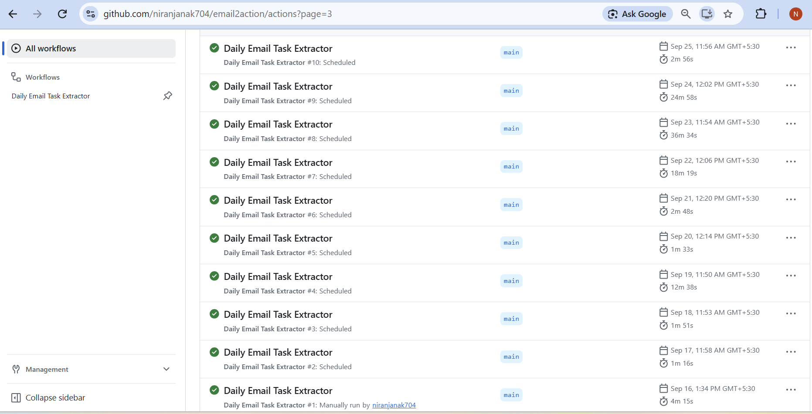

# Email2Action

Turn email overload into a clear, actionable to-do list.

Email2Action is an automated email-to-task management system that identifies actionable emails, extracts important tasks using Gemini AI, and converts them into Google Tasks.

**Tech Stack:** Python | Gmail API | Gemini API | Google Tasks API | OAuth 2.0

## Google Tasks


## Github Actions



## Key Features

- **Email Filtering:** Identifies actionable emails while filtering out newsletters, promotional messages, and general notifications.
- **AI-Powered Classification:** Uses Gemini to understand email content and determine whether a response or action is required.
- **Task Extraction:** Extracts assignments, deadlines, meeting requests, and follow-up actions.
- **Automatic Task Creation:** Converts extracted actions into Google Tasks, including due dates when available.
- **Duplicate Prevention:** Maintains a processing checkpoint to avoid repeatedly processing previously handled emails.
- **Daily Automation:** Supports scheduled execution for automated inbox management.

## How It Works

1. **Gmail Integration:** Fetches newly received emails using the Gmail API.
2. **AI Processing:** Sends email content to Gemini for actionability classification and task extraction.
3. **Task Generation:** Converts actionable information into Google Tasks using the Google Tasks API.
4. **Checkpoint Management:** Updates the processing checkpoint to track handled emails and prevent unnecessary reprocessing.

## Project Structure

```text
Email2Action/
│
├── main.py
├── quickstart.py
├── requirements.txt
│
└── src/
    ├── auth.py
    ├── gemini_processor.py
    ├── gmail_fetcher.py
    └── tasks_creator.py
```

## Installation & Setup

**1. Clone the repository**

```bash
git clone <repository-url>
cd Email2Action
```

**2. Install dependencies**

```bash
pip install -r requirements.txt
```

**3. Configure Gemini API Key**

Create a `.env` file and add:

```env
GEMINI_API_KEY=your_api_key
```

**4. Configure Google OAuth**

- Create a Google Cloud project.
- Enable Gmail API and Google Tasks API.
- Configure OAuth 2.0 credentials.
- Place the downloaded `credentials.json` in the project root.

**5. Run the application**

```bash
python main.py
```

To run an optional quick test:

```bash
python quickstart.py
```

## Security

- Keep API keys and OAuth credentials private.
- Never commit `.env`, `credentials.json`, or `token.json` to GitHub.
- Add sensitive files to `.gitignore`.

## Use Cases

- Managing university assignments and submission deadlines.
- Tracking meeting invitations and follow-ups.
- Organizing work-related action items.
- Reducing manual email management.

## Future Improvements

- Web-based dashboard for task management.
- Priority-based task classification.
- Email summarization.
- Improved deadline detection and task scheduling.s